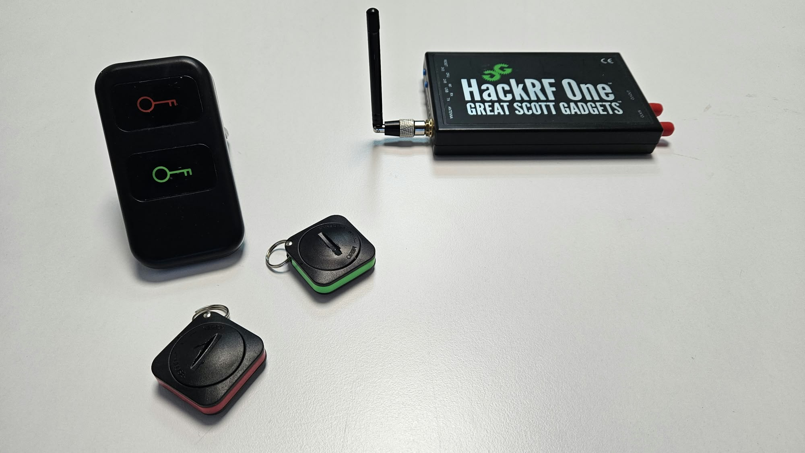

# Simple Replay Attack Demo with GNU Radio and HackRF

This workshop showcases replay attacks on a mini-setup which includes a key finder and a HackRF One. It aims to show a variety of doing a replay attack and also GNU Radio can be used in every step of the attempt.  

In the workshop, we will be using a simple RF radio device (a remote control), and a transmit-capable SDR ( Great Scott Gadget's HackRF One) in order to receive and transmit radio signals. The remote is used to turn on sound generation. It has red and green buttons onside. We will first search the signal from the original transmitter, capture it, and save it to replay later. In the first part of the workshop, we will use HackRF along with GNU Radio to do replay attack with a captured radio signal. In the second part, HackRF native tools will be utilized to do the same. In the last part, RF data from the remote control will be analyzed and decoded with the help of Inspectrum application, and GNU Radio will be used to synthesize the signal. 
